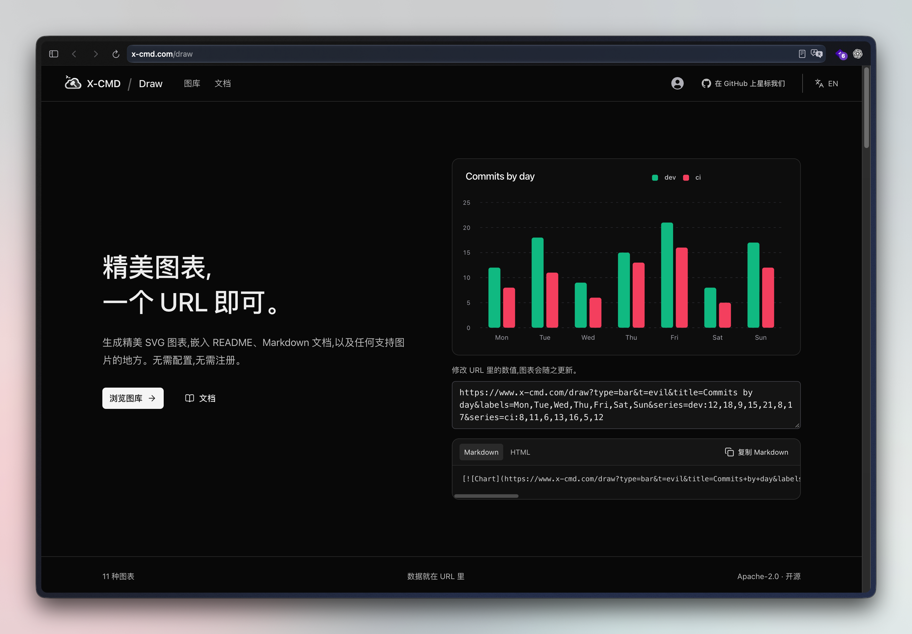

# draw — Verileri URL’de taşıyan SVG grafikler

> [English](../README.md) | **Türkçe**

[](https://jsr.io/@x-cmd/draw/score)
[](https://securityscorecards.dev/viewer/?uri=github.com/x-cmd/draw)


X-CMD Draw, açık kaynaklı bir SVG grafik oluşturma aracıdır: verileri ve stilleri URL’ye ekleyerek sütun ve çizgi grafikler, Sankey diyagramları, sistem mimarisi şemaları, zihin haritaları ve daha birçok görsel oluşturabilirsiniz.



Grafikler doğrudan README, issue, PR, blog yazıları ve web sayfalarına gömülebilir; görsel dosyalarını dışa aktarmaya veya yüklemeye gerek yoktur. Bağlantılar ve SVG, makine tarafından okunabilir verileri ve parametreleri korur: okuyucular grafiği görürken AI Agent görüntüyü tanımadan okumaya, değiştirmeye ve yeniden oluşturmaya devam edebilir.

## Örnekler

Performans analizinden mimari tasarıma, haritalardan zaman planlamasına kadar her grafiğin tanımı bağlantıda saklanır. Verileri görüntülemek, stili değiştirmek ve grafiği yeniden oluşturmak için görsele tıklayın. [Daha fazla grafik örneği ↗](https://x-cmd.com/draw)

| | |
| --- | --- |
| **Agent maliyeti ve başarı oranı**<br>[![Tüm modeller](https://www.x-cmd.com/draw/echarts?d=%7B%22backgroundColor%22%3A%22%230b0d12%22%2C%22animation%22%3Afalse%2C%22title%22%3A%7B%22text%22%3A%22T%C3%BCm%20modeller%22%2C%22subtext%22%3A%22FrontierHarness%20v1.1%20%C2%B7%20maliyet%20%2F%20ba%C5%9Far%C4%B1%20oran%C4%B1%22%2C%22left%22%3A18%2C%22top%22%3A12%2C%22textStyle%22%3A%7B%22color%22%3A%22%23e6edf3%22%2C%22fontSize%22%3A18%7D%2C%22subtextStyle%22%3A%7B%22color%22%3A%22%238b949e%22%2C%22fontSize%22%3A12%7D%7D%2C%22grid%22%3A%7B%22left%22%3A64%2C%22right%22%3A190%2C%22top%22%3A88%2C%22bottom%22%3A64%7D%2C%22xAxis%22%3A%7B%22type%22%3A%22value%22%2C%22name%22%3A%22g%C3%B6rev%20ba%C5%9F%C4%B1na%20ortalama%20maliyet%20%E2%86%92%22%2C%22nameLocation%22%3A%22end%22%2C%22nameGap%22%3A12%2C%22min%22%3A0.5%2C%22max%22%3A0.95%2C%22interval%22%3A0.05%2C%22axisLabel%22%3A%7B%22formatter%22%3A%22%24%7Bvalue%7D%22%2C%22color%22%3A%22%238b949e%22%7D%2C%22nameTextStyle%22%3A%7B%22color%22%3A%22%238b949e%22%7D%2C%22splitLine%22%3A%7B%22lineStyle%22%3A%7B%22color%22%3A%22%2322262d%22%7D%7D%7D%2C%22yAxis%22%3A%7B%22type%22%3A%22value%22%2C%22name%22%3A%22%E2%86%91%20ba%C5%9Far%C4%B1%20oran%C4%B1%22%2C%22nameLocation%22%3A%22end%22%2C%22nameGap%22%3A16%2C%22min%22%3A50%2C%22max%22%3A64%2C%22interval%22%3A2%2C%22axisLabel%22%3A%7B%22formatter%22%3A%22%7Bvalue%7D%25%22%2C%22color%22%3A%22%238b949e%22%7D%2C%22nameTextStyle%22%3A%7B%22color%22%3A%22%238b949e%22%7D%2C%22splitLine%22%3A%7B%22lineStyle%22%3A%7B%22color%22%3A%22%2322262d%22%7D%7D%7D%2C%22series%22%3A%5B%7B%22name%22%3A%22Pareto%20s%C4%B1n%C4%B1r%C4%B1%22%2C%22type%22%3A%22line%22%2C%22data%22%3A%5B%5B0.563%2C57.7%5D%2C%5B0.573%2C61.1%5D%2C%5B0.659%2C61.9%5D%5D%2C%22showSymbol%22%3Afalse%2C%22lineStyle%22%3A%7B%22type%22%3A%22dashed%22%2C%22color%22%3A%22%236e7681%22%2C%22width%22%3A1.5%7D%2C%22silent%22%3Atrue%2C%22z%22%3A1%7D%2C%7B%22name%22%3A%22Test%20ortam%C4%B1%22%2C%22type%22%3A%22scatter%22%2C%22symbolSize%22%3A14%2C%22data%22%3A%5B%7B%22name%22%3A%22Codex%20CLI%22%2C%22value%22%3A%5B0.573%2C61.1%5D%2C%22itemStyle%22%3A%7B%22color%22%3A%22%2339c5cf%22%7D%2C%22label%22%3A%7B%22color%22%3A%22%2339c5cf%22%2C%22position%22%3A%22left%22%7D%7D%2C%7B%22name%22%3A%22Pi%22%2C%22value%22%3A%5B0.563%2C57.7%5D%2C%22itemStyle%22%3A%7B%22color%22%3A%22%23c678dd%22%7D%2C%22label%22%3A%7B%22color%22%3A%22%23c678dd%22%2C%22position%22%3A%22left%22%7D%7D%2C%7B%22name%22%3A%22Oh%20My%20Pi%22%2C%22value%22%3A%5B0.564%2C57.3%5D%2C%22itemStyle%22%3A%7B%22color%22%3A%22%23a371f7%22%7D%2C%22label%22%3A%7B%22color%22%3A%22%23a371f7%22%2C%22position%22%3A%22bottom%22%7D%7D%2C%7B%22name%22%3A%22ZCode%22%2C%22value%22%3A%5B0.659%2C61.9%5D%2C%22itemStyle%22%3A%7B%22color%22%3A%22%23d4b57e%22%7D%2C%22label%22%3A%7B%22color%22%3A%22%23d4b57e%22%2C%22position%22%3A%22right%22%7D%7D%2C%7B%22name%22%3A%22KimiCode%22%2C%22value%22%3A%5B0.653%2C60.2%5D%2C%22itemStyle%22%3A%7B%22color%22%3A%22%23f778ba%22%7D%2C%22label%22%3A%7B%22color%22%3A%22%23f778ba%22%2C%22position%22%3A%22left%22%7D%7D%2C%7B%22name%22%3A%22OpenCode%22%2C%22value%22%3A%5B0.646%2C57.4%5D%2C%22itemStyle%22%3A%7B%22color%22%3A%22%23e3b341%22%7D%2C%22label%22%3A%7B%22color%22%3A%22%23e3b341%22%2C%22position%22%3A%22left%22%7D%7D%2C%7B%22name%22%3A%22Maka%22%2C%22value%22%3A%5B0.654%2C57.7%5D%2C%22itemStyle%22%3A%7B%22color%22%3A%22%23f0df72%22%7D%2C%22label%22%3A%7B%22color%22%3A%22%23f0df72%22%2C%22position%22%3A%22top%22%7D%7D%2C%7B%22name%22%3A%22MiniMax%20Code%22%2C%22value%22%3A%5B0.647%2C56.8%5D%2C%22itemStyle%22%3A%7B%22color%22%3A%22%23ff7b72%22%7D%2C%22label%22%3A%7B%22color%22%3A%22%23ff7b72%22%2C%22position%22%3A%22bottom%22%7D%7D%2C%7B%22name%22%3A%22DeepSeek%20Harness%3A%20Minimal%22%2C%22value%22%3A%5B0.661%2C57.4%5D%2C%22itemStyle%22%3A%7B%22color%22%3A%22%2379c0ff%22%7D%2C%22label%22%3A%7B%22color%22%3A%22%2379c0ff%22%2C%22position%22%3A%22right%22%7D%7D%2C%7B%22name%22%3A%22Hermes%20Agent%22%2C%22value%22%3A%5B0.692%2C59.9%5D%2C%22itemStyle%22%3A%7B%22color%22%3A%22%23d2a8ff%22%7D%2C%22label%22%3A%7B%22color%22%3A%22%23d2a8ff%22%2C%22position%22%3A%22left%22%7D%7D%2C%7B%22name%22%3A%22Cline%20CLI%22%2C%22value%22%3A%5B0.689%2C57.7%5D%2C%22itemStyle%22%3A%7B%22color%22%3A%22%2356d4dd%22%7D%2C%22label%22%3A%7B%22color%22%3A%22%2356d4dd%22%2C%22position%22%3A%22right%22%7D%7D%2C%7B%22name%22%3A%22Grok%20Build%22%2C%22value%22%3A%5B0.723%2C60%5D%2C%22itemStyle%22%3A%7B%22color%22%3A%22%23e3b341%22%7D%2C%22label%22%3A%7B%22color%22%3A%22%23e3b341%22%2C%22position%22%3A%22right%22%7D%7D%2C%7B%22name%22%3A%22Alma%22%2C%22value%22%3A%5B0.731%2C59.7%5D%2C%22itemStyle%22%3A%7B%22color%22%3A%22%23ffa657%22%7D%2C%22label%22%3A%7B%22color%22%3A%22%23ffa657%22%2C%22position%22%3A%22right%22%7D%7D%2C%7B%22name%22%3A%22DeepSeek%20Harness%3A%20Standard%22%2C%22value%22%3A%5B0.697%2C55%5D%2C%22itemStyle%22%3A%7B%22color%22%3A%22%23a5d6ff%22%7D%2C%22label%22%3A%7B%22color%22%3A%22%23a5d6ff%22%2C%22position%22%3A%22left%22%7D%7D%2C%7B%22name%22%3A%22DeepSeek%20Harness%3A%20Creator%22%2C%22value%22%3A%5B0.713%2C56.1%5D%2C%22itemStyle%22%3A%7B%22color%22%3A%22%231f6feb%22%7D%2C%22label%22%3A%7B%22color%22%3A%22%231f6feb%22%2C%22position%22%3A%22left%22%7D%7D%2C%7B%22name%22%3A%22mini-SWE-agent%22%2C%22value%22%3A%5B0.757%2C58.6%5D%2C%22itemStyle%22%3A%7B%22color%22%3A%22%238b949e%22%7D%2C%22label%22%3A%7B%22color%22%3A%22%238b949e%22%2C%22position%22%3A%22right%22%7D%7D%2C%7B%22name%22%3A%22DeepSeek%20Harness%3A%20Code%22%2C%22value%22%3A%5B0.732%2C55.2%5D%2C%22itemStyle%22%3A%7B%22color%22%3A%22%2356d4dd%22%7D%2C%22label%22%3A%7B%22color%22%3A%22%2356d4dd%22%2C%22position%22%3A%22bottom%22%7D%7D%2C%7B%22name%22%3A%22Exo%22%2C%22value%22%3A%5B0.691%2C50.6%5D%2C%22itemStyle%22%3A%7B%22color%22%3A%22%2356d364%22%7D%2C%22label%22%3A%7B%22color%22%3A%22%2356d364%22%2C%22position%22%3A%22right%22%7D%7D%2C%7B%22name%22%3A%22GitHub%20Copilot%20CLI%22%2C%22value%22%3A%5B0.787%2C56.9%5D%2C%22itemStyle%22%3A%7B%22color%22%3A%22%23d2a8ff%22%7D%2C%22label%22%3A%7B%22color%22%3A%22%23d2a8ff%22%2C%22position%22%3A%22right%22%7D%7D%2C%7B%22name%22%3A%22Claude%20Code%22%2C%22value%22%3A%5B0.915%2C58.9%5D%2C%22itemStyle%22%3A%7B%22color%22%3A%22%23ff9e80%22%7D%2C%22label%22%3A%7B%22color%22%3A%22%23ff9e80%22%2C%22position%22%3A%22left%22%7D%7D%2C%7B%22name%22%3A%22Antigravity%20CLI%22%2C%22value%22%3A%5B0.897%2C55%5D%2C%22itemStyle%22%3A%7B%22color%22%3A%22%237ee787%22%7D%2C%22label%22%3A%7B%22color%22%3A%22%237ee787%22%2C%22position%22%3A%22right%22%7D%7D%5D%2C%22label%22%3A%7B%22show%22%3Atrue%2C%22formatter%22%3A%22%7Bb%7D%22%2C%22position%22%3A%22right%22%2C%22fontSize%22%3A11%2C%22distance%22%3A8%7D%2C%22labelLayout%22%3A%7B%22moveOverlap%22%3A%22shiftY%22%7D%2C%22itemStyle%22%3A%7B%22borderColor%22%3A%22%230b0d12%22%2C%22borderWidth%22%3A2%7D%2C%22z%22%3A3%7D%5D%7D&w=960&h=540)](https://www.x-cmd.com/draw/explore/echarts?d=%7B%22backgroundColor%22%3A%22%230b0d12%22%2C%22animation%22%3Afalse%2C%22title%22%3A%7B%22text%22%3A%22T%C3%BCm%20modeller%22%2C%22subtext%22%3A%22FrontierHarness%20v1.1%20%C2%B7%20maliyet%20%2F%20ba%C5%9Far%C4%B1%20oran%C4%B1%22%2C%22left%22%3A18%2C%22top%22%3A12%2C%22textStyle%22%3A%7B%22color%22%3A%22%23e6edf3%22%2C%22fontSize%22%3A18%7D%2C%22subtextStyle%22%3A%7B%22color%22%3A%22%238b949e%22%2C%22fontSize%22%3A12%7D%7D%2C%22grid%22%3A%7B%22left%22%3A64%2C%22right%22%3A190%2C%22top%22%3A88%2C%22bottom%22%3A64%7D%2C%22xAxis%22%3A%7B%22type%22%3A%22value%22%2C%22name%22%3A%22g%C3%B6rev%20ba%C5%9F%C4%B1na%20ortalama%20maliyet%20%E2%86%92%22%2C%22nameLocation%22%3A%22end%22%2C%22nameGap%22%3A12%2C%22min%22%3A0.5%2C%22max%22%3A0.95%2C%22interval%22%3A0.05%2C%22axisLabel%22%3A%7B%22formatter%22%3A%22%24%7Bvalue%7D%22%2C%22color%22%3A%22%238b949e%22%7D%2C%22nameTextStyle%22%3A%7B%22color%22%3A%22%238b949e%22%7D%2C%22splitLine%22%3A%7B%22lineStyle%22%3A%7B%22color%22%3A%22%2322262d%22%7D%7D%7D%2C%22yAxis%22%3A%7B%22type%22%3A%22value%22%2C%22name%22%3A%22%E2%86%91%20ba%C5%9Far%C4%B1%20oran%C4%B1%22%2C%22nameLocation%22%3A%22end%22%2C%22nameGap%22%3A16%2C%22min%22%3A50%2C%22max%22%3A64%2C%22interval%22%3A2%2C%22axisLabel%22%3A%7B%22formatter%22%3A%22%7Bvalue%7D%25%22%2C%22color%22%3A%22%238b949e%22%7D%2C%22nameTextStyle%22%3A%7B%22color%22%3A%22%238b949e%22%7D%2C%22splitLine%22%3A%7B%22lineStyle%22%3A%7B%22color%22%3A%22%2322262d%22%7D%7D%7D%2C%22series%22%3A%5B%7B%22name%22%3A%22Pareto%20s%C4%B1n%C4%B1r%C4%B1%22%2C%22type%22%3A%22line%22%2C%22data%22%3A%5B%5B0.563%2C57.7%5D%2C%5B0.573%2C61.1%5D%2C%5B0.659%2C61.9%5D%5D%2C%22showSymbol%22%3Afalse%2C%22lineStyle%22%3A%7B%22type%22%3A%22dashed%22%2C%22color%22%3A%22%236e7681%22%2C%22width%22%3A1.5%7D%2C%22silent%22%3Atrue%2C%22z%22%3A1%7D%2C%7B%22name%22%3A%22Test%20ortam%C4%B1%22%2C%22type%22%3A%22scatter%22%2C%22symbolSize%22%3A14%2C%22data%22%3A%5B%7B%22name%22%3A%22Codex%20CLI%22%2C%22value%22%3A%5B0.573%2C61.1%5D%2C%22itemStyle%22%3A%7B%22color%22%3A%22%2339c5cf%22%7D%2C%22label%22%3A%7B%22color%22%3A%22%2339c5cf%22%2C%22position%22%3A%22left%22%7D%7D%2C%7B%22name%22%3A%22Pi%22%2C%22value%22%3A%5B0.563%2C57.7%5D%2C%22itemStyle%22%3A%7B%22color%22%3A%22%23c678dd%22%7D%2C%22label%22%3A%7B%22color%22%3A%22%23c678dd%22%2C%22position%22%3A%22left%22%7D%7D%2C%7B%22name%22%3A%22Oh%20My%20Pi%22%2C%22value%22%3A%5B0.564%2C57.3%5D%2C%22itemStyle%22%3A%7B%22color%22%3A%22%23a371f7%22%7D%2C%22label%22%3A%7B%22color%22%3A%22%23a371f7%22%2C%22position%22%3A%22bottom%22%7D%7D%2C%7B%22name%22%3A%22ZCode%22%2C%22value%22%3A%5B0.659%2C61.9%5D%2C%22itemStyle%22%3A%7B%22color%22%3A%22%23d4b57e%22%7D%2C%22label%22%3A%7B%22color%22%3A%22%23d4b57e%22%2C%22position%22%3A%22right%22%7D%7D%2C%7B%22name%22%3A%22KimiCode%22%2C%22value%22%3A%5B0.653%2C60.2%5D%2C%22itemStyle%22%3A%7B%22color%22%3A%22%23f778ba%22%7D%2C%22label%22%3A%7B%22color%22%3A%22%23f778ba%22%2C%22position%22%3A%22left%22%7D%7D%2C%7B%22name%22%3A%22OpenCode%22%2C%22value%22%3A%5B0.646%2C57.4%5D%2C%22itemStyle%22%3A%7B%22color%22%3A%22%23e3b341%22%7D%2C%22label%22%3A%7B%22color%22%3A%22%23e3b341%22%2C%22position%22%3A%22left%22%7D%7D%2C%7B%22name%22%3A%22Maka%22%2C%22value%22%3A%5B0.654%2C57.7%5D%2C%22itemStyle%22%3A%7B%22color%22%3A%22%23f0df72%22%7D%2C%22label%22%3A%7B%22color%22%3A%22%23f0df72%22%2C%22position%22%3A%22top%22%7D%7D%2C%7B%22name%22%3A%22MiniMax%20Code%22%2C%22value%22%3A%5B0.647%2C56.8%5D%2C%22itemStyle%22%3A%7B%22color%22%3A%22%23ff7b72%22%7D%2C%22label%22%3A%7B%22color%22%3A%22%23ff7b72%22%2C%22position%22%3A%22bottom%22%7D%7D%2C%7B%22name%22%3A%22DeepSeek%20Harness%3A%20Minimal%22%2C%22value%22%3A%5B0.661%2C57.4%5D%2C%22itemStyle%22%3A%7B%22color%22%3A%22%2379c0ff%22%7D%2C%22label%22%3A%7B%22color%22%3A%22%2379c0ff%22%2C%22position%22%3A%22right%22%7D%7D%2C%7B%22name%22%3A%22Hermes%20Agent%22%2C%22value%22%3A%5B0.692%2C59.9%5D%2C%22itemStyle%22%3A%7B%22color%22%3A%22%23d2a8ff%22%7D%2C%22label%22%3A%7B%22color%22%3A%22%23d2a8ff%22%2C%22position%22%3A%22left%22%7D%7D%2C%7B%22name%22%3A%22Cline%20CLI%22%2C%22value%22%3A%5B0.689%2C57.7%5D%2C%22itemStyle%22%3A%7B%22color%22%3A%22%2356d4dd%22%7D%2C%22label%22%3A%7B%22color%22%3A%22%2356d4dd%22%2C%22position%22%3A%22right%22%7D%7D%2C%7B%22name%22%3A%22Grok%20Build%22%2C%22value%22%3A%5B0.723%2C60%5D%2C%22itemStyle%22%3A%7B%22color%22%3A%22%23e3b341%22%7D%2C%22label%22%3A%7B%22color%22%3A%22%23e3b341%22%2C%22position%22%3A%22right%22%7D%7D%2C%7B%22name%22%3A%22Alma%22%2C%22value%22%3A%5B0.731%2C59.7%5D%2C%22itemStyle%22%3A%7B%22color%22%3A%22%23ffa657%22%7D%2C%22label%22%3A%7B%22color%22%3A%22%23ffa657%22%2C%22position%22%3A%22right%22%7D%7D%2C%7B%22name%22%3A%22DeepSeek%20Harness%3A%20Standard%22%2C%22value%22%3A%5B0.697%2C55%5D%2C%22itemStyle%22%3A%7B%22color%22%3A%22%23a5d6ff%22%7D%2C%22label%22%3A%7B%22color%22%3A%22%23a5d6ff%22%2C%22position%22%3A%22left%22%7D%7D%2C%7B%22name%22%3A%22DeepSeek%20Harness%3A%20Creator%22%2C%22value%22%3A%5B0.713%2C56.1%5D%2C%22itemStyle%22%3A%7B%22color%22%3A%22%231f6feb%22%7D%2C%22label%22%3A%7B%22color%22%3A%22%231f6feb%22%2C%22position%22%3A%22left%22%7D%7D%2C%7B%22name%22%3A%22mini-SWE-agent%22%2C%22value%22%3A%5B0.757%2C58.6%5D%2C%22itemStyle%22%3A%7B%22color%22%3A%22%238b949e%22%7D%2C%22label%22%3A%7B%22color%22%3A%22%238b949e%22%2C%22position%22%3A%22right%22%7D%7D%2C%7B%22name%22%3A%22DeepSeek%20Harness%3A%20Code%22%2C%22value%22%3A%5B0.732%2C55.2%5D%2C%22itemStyle%22%3A%7B%22color%22%3A%22%2356d4dd%22%7D%2C%22label%22%3A%7B%22color%22%3A%22%2356d4dd%22%2C%22position%22%3A%22bottom%22%7D%7D%2C%7B%22name%22%3A%22Exo%22%2C%22value%22%3A%5B0.691%2C50.6%5D%2C%22itemStyle%22%3A%7B%22color%22%3A%22%2356d364%22%7D%2C%22label%22%3A%7B%22color%22%3A%22%2356d364%22%2C%22position%22%3A%22right%22%7D%7D%2C%7B%22name%22%3A%22GitHub%20Copilot%20CLI%22%2C%22value%22%3A%5B0.787%2C56.9%5D%2C%22itemStyle%22%3A%7B%22color%22%3A%22%23d2a8ff%22%7D%2C%22label%22%3A%7B%22color%22%3A%22%23d2a8ff%22%2C%22position%22%3A%22right%22%7D%7D%2C%7B%22name%22%3A%22Claude%20Code%22%2C%22value%22%3A%5B0.915%2C58.9%5D%2C%22itemStyle%22%3A%7B%22color%22%3A%22%23ff9e80%22%7D%2C%22label%22%3A%7B%22color%22%3A%22%23ff9e80%22%2C%22position%22%3A%22left%22%7D%7D%2C%7B%22name%22%3A%22Antigravity%20CLI%22%2C%22value%22%3A%5B0.897%2C55%5D%2C%22itemStyle%22%3A%7B%22color%22%3A%22%237ee787%22%7D%2C%22label%22%3A%7B%22color%22%3A%22%237ee787%22%2C%22position%22%3A%22right%22%7D%7D%5D%2C%22label%22%3A%7B%22show%22%3Atrue%2C%22formatter%22%3A%22%7Bb%7D%22%2C%22position%22%3A%22right%22%2C%22fontSize%22%3A11%2C%22distance%22%3A8%7D%2C%22labelLayout%22%3A%7B%22moveOverlap%22%3A%22shiftY%22%7D%2C%22itemStyle%22%3A%7B%22borderColor%22%3A%22%230b0d12%22%2C%22borderWidth%22%3A2%7D%2C%22z%22%3A3%7D%5D%7D) | **Sıkıştırma algoritmalarının performans karşılaştırması**<br>[![Sıkıştırma: hız ve oran](https://www.x-cmd.com/draw/echarts?d=%7B%22backgroundColor%22%3A%22%230f172a%22%2C%22title%22%3A%7B%22text%22%3A%22S%C4%B1k%C4%B1%C5%9Ft%C4%B1rma%3A%20h%C4%B1z%20ve%20oran%22%2C%22subtext%22%3A%22Silesia%20%C2%B7%20i7-9700K%20%C2%B7%20lzbench%20%C2%B7%20baloncuk%20boyutu%20%3D%20a%C3%A7ma%20h%C4%B1z%C4%B1%22%2C%22left%22%3A%22center%22%2C%22textStyle%22%3A%7B%22color%22%3A%22%23f8fafc%22%7D%2C%22subtextStyle%22%3A%7B%22color%22%3A%22%2394a3b8%22%7D%7D%2C%22grid%22%3A%7B%22left%22%3A70%2C%22right%22%3A40%2C%22top%22%3A80%2C%22bottom%22%3A60%7D%2C%22xAxis%22%3A%7B%22name%22%3A%22S%C4%B1k%C4%B1%C5%9Ft%C4%B1rma%20h%C4%B1z%C4%B1%20MB%2Fs%20%28daha%20h%C4%B1zl%C4%B1%20%E2%86%92%29%22%2C%22min%22%3A0%2C%22max%22%3A800%2C%22nameLocation%22%3A%22middle%22%2C%22nameGap%22%3A32%2C%22nameTextStyle%22%3A%7B%22color%22%3A%22%2394a3b8%22%7D%2C%22axisLabel%22%3A%7B%22color%22%3A%22%2394a3b8%22%7D%2C%22splitLine%22%3A%7B%22lineStyle%22%3A%7B%22color%22%3A%22%231e293b%22%7D%7D%7D%2C%22yAxis%22%3A%7B%22name%22%3A%22Oran%20%28daha%20k%C3%BC%C3%A7%C3%BCk%20%C3%A7%C4%B1kt%C4%B1%20%E2%86%91%29%22%2C%22min%22%3A1.9%2C%22max%22%3A3%2C%22nameLocation%22%3A%22middle%22%2C%22nameGap%22%3A45%2C%22nameTextStyle%22%3A%7B%22color%22%3A%22%2394a3b8%22%7D%2C%22axisLabel%22%3A%7B%22color%22%3A%22%2394a3b8%22%7D%2C%22splitLine%22%3A%7B%22lineStyle%22%3A%7B%22color%22%3A%22%231e293b%22%7D%7D%7D%2C%22series%22%3A%5B%7B%22type%22%3A%22scatter%22%2C%22data%22%3A%5B%7B%22name%22%3A%22zstd%20-1%22%2C%22value%22%3A%5B510%2C2.896%5D%2C%22symbolSize%22%3A28%2C%22itemStyle%22%3A%7B%22color%22%3A%22%2322d3ee%22%7D%2C%22label%22%3A%7B%22position%22%3A%22top%22%7D%7D%2C%7B%22name%22%3A%22zstd%20--fast%3D1%22%2C%22value%22%3A%5B545%2C2.439%5D%2C%22symbolSize%22%3A30%2C%22itemStyle%22%3A%7B%22color%22%3A%22%2322d3ee%22%7D%2C%22label%22%3A%7B%22position%22%3A%22top%22%7D%7D%2C%7B%22name%22%3A%22zstd%20--fast%3D4%22%2C%22value%22%3A%5B665%2C2.146%5D%2C%22symbolSize%22%3A31%2C%22itemStyle%22%3A%7B%22color%22%3A%22%2322d3ee%22%7D%2C%22label%22%3A%7B%22position%22%3A%22top%22%7D%7D%2C%7B%22name%22%3A%22brotli%20-1%22%2C%22value%22%3A%5B290%2C2.883%5D%2C%22symbolSize%22%3A21%2C%22itemStyle%22%3A%7B%22color%22%3A%22%23a78bfa%22%7D%2C%22label%22%3A%7B%22position%22%3A%22top%22%7D%7D%2C%7B%22name%22%3A%22zlib%20-1%22%2C%22value%22%3A%5B105%2C2.743%5D%2C%22symbolSize%22%3A20%2C%22itemStyle%22%3A%7B%22color%22%3A%22%23f87171%22%7D%2C%22label%22%3A%7B%22position%22%3A%22top%22%7D%7D%2C%7B%22name%22%3A%22lz4%22%2C%22value%22%3A%5B675%2C2.101%5D%2C%22symbolSize%22%3A38%2C%22itemStyle%22%3A%7B%22color%22%3A%22%23fbbf24%22%7D%2C%22label%22%3A%7B%22position%22%3A%22right%22%7D%7D%2C%7B%22name%22%3A%22lzo1x%22%2C%22value%22%3A%5B650%2C2.106%5D%2C%22symbolSize%22%3A24%2C%22itemStyle%22%3A%7B%22color%22%3A%22%2394a3b8%22%7D%2C%22label%22%3A%7B%22position%22%3A%22left%22%7D%7D%2C%7B%22name%22%3A%22snappy%22%2C%22value%22%3A%5B520%2C2.089%5D%2C%22symbolSize%22%3A28%2C%22itemStyle%22%3A%7B%22color%22%3A%22%2394a3b8%22%7D%2C%22label%22%3A%7B%22position%22%3A%22bottom%22%7D%7D%2C%7B%22name%22%3A%22quicklz%22%2C%22value%22%3A%5B520%2C2.238%5D%2C%22symbolSize%22%3A23%2C%22itemStyle%22%3A%7B%22color%22%3A%22%2394a3b8%22%7D%2C%22label%22%3A%7B%22position%22%3A%22top%22%7D%7D%2C%7B%22name%22%3A%22lzf%22%2C%22value%22%3A%5B410%2C2.077%5D%2C%22symbolSize%22%3A24%2C%22itemStyle%22%3A%7B%22color%22%3A%22%2394a3b8%22%7D%2C%22label%22%3A%7B%22position%22%3A%22bottom%22%7D%7D%5D%2C%22itemStyle%22%3A%7B%22opacity%22%3A0.85%2C%22borderColor%22%3A%22%23fff%22%2C%22borderWidth%22%3A1%7D%2C%22label%22%3A%7B%22show%22%3Atrue%2C%22formatter%22%3A%22%7Bb%7D%22%2C%22color%22%3A%22%23e2e8f0%22%2C%22fontSize%22%3A12%7D%7D%5D%7D&w=960&h=540)](https://www.x-cmd.com/draw/explore/echarts?d=%7B%22backgroundColor%22%3A%22%230f172a%22%2C%22title%22%3A%7B%22text%22%3A%22S%C4%B1k%C4%B1%C5%9Ft%C4%B1rma%3A%20h%C4%B1z%20ve%20oran%22%2C%22subtext%22%3A%22Silesia%20%C2%B7%20i7-9700K%20%C2%B7%20lzbench%20%C2%B7%20baloncuk%20boyutu%20%3D%20a%C3%A7ma%20h%C4%B1z%C4%B1%22%2C%22left%22%3A%22center%22%2C%22textStyle%22%3A%7B%22color%22%3A%22%23f8fafc%22%7D%2C%22subtextStyle%22%3A%7B%22color%22%3A%22%2394a3b8%22%7D%7D%2C%22grid%22%3A%7B%22left%22%3A70%2C%22right%22%3A40%2C%22top%22%3A80%2C%22bottom%22%3A60%7D%2C%22xAxis%22%3A%7B%22name%22%3A%22S%C4%B1k%C4%B1%C5%9Ft%C4%B1rma%20h%C4%B1z%C4%B1%20MB%2Fs%20%28daha%20h%C4%B1zl%C4%B1%20%E2%86%92%29%22%2C%22min%22%3A0%2C%22max%22%3A800%2C%22nameLocation%22%3A%22middle%22%2C%22nameGap%22%3A32%2C%22nameTextStyle%22%3A%7B%22color%22%3A%22%2394a3b8%22%7D%2C%22axisLabel%22%3A%7B%22color%22%3A%22%2394a3b8%22%7D%2C%22splitLine%22%3A%7B%22lineStyle%22%3A%7B%22color%22%3A%22%231e293b%22%7D%7D%7D%2C%22yAxis%22%3A%7B%22name%22%3A%22Oran%20%28daha%20k%C3%BC%C3%A7%C3%BCk%20%C3%A7%C4%B1kt%C4%B1%20%E2%86%91%29%22%2C%22min%22%3A1.9%2C%22max%22%3A3%2C%22nameLocation%22%3A%22middle%22%2C%22nameGap%22%3A45%2C%22nameTextStyle%22%3A%7B%22color%22%3A%22%2394a3b8%22%7D%2C%22axisLabel%22%3A%7B%22color%22%3A%22%2394a3b8%22%7D%2C%22splitLine%22%3A%7B%22lineStyle%22%3A%7B%22color%22%3A%22%231e293b%22%7D%7D%7D%2C%22series%22%3A%5B%7B%22type%22%3A%22scatter%22%2C%22data%22%3A%5B%7B%22name%22%3A%22zstd%20-1%22%2C%22value%22%3A%5B510%2C2.896%5D%2C%22symbolSize%22%3A28%2C%22itemStyle%22%3A%7B%22color%22%3A%22%2322d3ee%22%7D%2C%22label%22%3A%7B%22position%22%3A%22top%22%7D%7D%2C%7B%22name%22%3A%22zstd%20--fast%3D1%22%2C%22value%22%3A%5B545%2C2.439%5D%2C%22symbolSize%22%3A30%2C%22itemStyle%22%3A%7B%22color%22%3A%22%2322d3ee%22%7D%2C%22label%22%3A%7B%22position%22%3A%22top%22%7D%7D%2C%7B%22name%22%3A%22zstd%20--fast%3D4%22%2C%22value%22%3A%5B665%2C2.146%5D%2C%22symbolSize%22%3A31%2C%22itemStyle%22%3A%7B%22color%22%3A%22%2322d3ee%22%7D%2C%22label%22%3A%7B%22position%22%3A%22top%22%7D%7D%2C%7B%22name%22%3A%22brotli%20-1%22%2C%22value%22%3A%5B290%2C2.883%5D%2C%22symbolSize%22%3A21%2C%22itemStyle%22%3A%7B%22color%22%3A%22%23a78bfa%22%7D%2C%22label%22%3A%7B%22position%22%3A%22top%22%7D%7D%2C%7B%22name%22%3A%22zlib%20-1%22%2C%22value%22%3A%5B105%2C2.743%5D%2C%22symbolSize%22%3A20%2C%22itemStyle%22%3A%7B%22color%22%3A%22%23f87171%22%7D%2C%22label%22%3A%7B%22position%22%3A%22top%22%7D%7D%2C%7B%22name%22%3A%22lz4%22%2C%22value%22%3A%5B675%2C2.101%5D%2C%22symbolSize%22%3A38%2C%22itemStyle%22%3A%7B%22color%22%3A%22%23fbbf24%22%7D%2C%22label%22%3A%7B%22position%22%3A%22right%22%7D%7D%2C%7B%22name%22%3A%22lzo1x%22%2C%22value%22%3A%5B650%2C2.106%5D%2C%22symbolSize%22%3A24%2C%22itemStyle%22%3A%7B%22color%22%3A%22%2394a3b8%22%7D%2C%22label%22%3A%7B%22position%22%3A%22left%22%7D%7D%2C%7B%22name%22%3A%22snappy%22%2C%22value%22%3A%5B520%2C2.089%5D%2C%22symbolSize%22%3A28%2C%22itemStyle%22%3A%7B%22color%22%3A%22%2394a3b8%22%7D%2C%22label%22%3A%7B%22position%22%3A%22bottom%22%7D%7D%2C%7B%22name%22%3A%22quicklz%22%2C%22value%22%3A%5B520%2C2.238%5D%2C%22symbolSize%22%3A23%2C%22itemStyle%22%3A%7B%22color%22%3A%22%2394a3b8%22%7D%2C%22label%22%3A%7B%22position%22%3A%22top%22%7D%7D%2C%7B%22name%22%3A%22lzf%22%2C%22value%22%3A%5B410%2C2.077%5D%2C%22symbolSize%22%3A24%2C%22itemStyle%22%3A%7B%22color%22%3A%22%2394a3b8%22%7D%2C%22label%22%3A%7B%22position%22%3A%22bottom%22%7D%7D%5D%2C%22itemStyle%22%3A%7B%22opacity%22%3A0.85%2C%22borderColor%22%3A%22%23fff%22%2C%22borderWidth%22%3A1%7D%2C%22label%22%3A%7B%22show%22%3Atrue%2C%22formatter%22%3A%22%7Bb%7D%22%2C%22color%22%3A%22%23e2e8f0%22%2C%22fontSize%22%3A12%7D%7D%5D%7D) |
| [![OpenCode projesinin genel mimarisi](https://www.x-cmd.com/draw/arch2?title=OpenCode+projesinin+genel+mimarisi&t=shadcn&n=tui%3Bfe%3BTerminal+aray%C3%BCz%C3%BC+TUI%3BKomut+sat%C4%B1r%C4%B1+etkile%C5%9Fimi%3Br0c0&n=web%3Bfe%3BWeb+aray%C3%BCz%C3%BC%3BTaray%C4%B1c%C4%B1+eri%C5%9Fimi%3Br0c1&n=desktop%3Bfe%3BMasa%C3%BCst%C3%BC+uygulamas%C4%B1%3BElectron+istemcisi%3Br0c2&n=sdk%3Bbe%3BJavaScript+SDK%3BProgramatik+entegrasyon%3Br1c0&n=server%3Bsvc%3BOpenCode+%C3%A7ekirdek+hizmeti%3BCLI+ve+HTTP+hizmeti%3Br1c1&n=session%3Bsvc%3BOturumlar+ve+mesajlar%3BBa%C4%9Flam+y%C3%B6netimi%3Br2c0&n=agent%3Bsvc%3BAgent+sistemi%3BBuild+Plan+alt+Agent%E2%80%99%C4%B1%3Br2c1&n=provider%3Bsvc%3BModel+sa%C4%9Flay%C4%B1c%C4%B1s%C4%B1%3BModel+istekleri+ve+yan%C4%B1tlar%C4%B1%3Br2c2&n=tools%3Bsvc%3BAra%C3%A7+sistemi%3BDosya+okuma+ve+yazma%2C+Bash%2C+arama%3Br3c0&n=mcp%3Bsvc%3BMCP+hizmeti%3BHarici+ara%C3%A7+ba%C4%9Flant%C4%B1s%C4%B1%3Br3c1&n=plugin%3Bsvc%3BEklentiler+ve+uzant%C4%B1lar%3BOlay+kancalar%C4%B1+ve+%C3%B6zel+yetenekler%3Br3c2&n=storage%3Bdb%3BYerel+depolama%3BSQLite+oturum+verileri%3Br4c1&e=tui%3Bserver%3BTerminal+iste%C4%9Fi&e=web%3Bserver%3BHTTP+API&e=desktop%3Bserver%3B%C4%B0stemci+iste%C4%9Fi&e=sdk%3Bserver%3BAPI+%C3%A7a%C4%9Fr%C4%B1s%C4%B1&e=server%3Bsession%3BOturumlar%C4%B1+y%C3%B6netme&e=server%3Bagent%3BAgent+orkestrasyonu&e=agent%3Bprovider%3BModel+iste%C4%9Fi&e=agent%3Btools%3BAra%C3%A7+%C3%A7a%C4%9F%C4%B1rma&e=tools%3Bmcp%3BAra%C3%A7+kaynaklar%C4%B1n%C4%B1+geni%C5%9Fletme&e=server%3Bplugin%3BUzant%C4%B1lar%C4%B1+y%C3%BCkleme&e=session%3Bstorage%3BOturumlar%C4%B1+okuma+ve+yazma&e=agent%3Bsession%3BMesaj+ba%C4%9Flam%C4%B1&b=%C4%B0stemci+giri%C5%9Fleri%3B+tui+web+desktop+sdk&b=%C3%87ekirdek+%C3%A7al%C4%B1%C5%9Fma+katman%C4%B1%3B+server+session+agent+provider&b=Uzant%C4%B1lar+ve+y%C3%BCr%C3%BCtme%3B+tools+mcp+plugin&b=Veri+kal%C4%B1c%C4%B1l%C4%B1%C4%9F%C4%B1%3B+storage)](https://www.x-cmd.com/draw/explore/arch2?title=OpenCode+projesinin+genel+mimarisi&t=shadcn&n=tui%3Bfe%3BTerminal+aray%C3%BCz%C3%BC+TUI%3BKomut+sat%C4%B1r%C4%B1+etkile%C5%9Fimi%3Br0c0&n=web%3Bfe%3BWeb+aray%C3%BCz%C3%BC%3BTaray%C4%B1c%C4%B1+eri%C5%9Fimi%3Br0c1&n=desktop%3Bfe%3BMasa%C3%BCst%C3%BC+uygulamas%C4%B1%3BElectron+istemcisi%3Br0c2&n=sdk%3Bbe%3BJavaScript+SDK%3BProgramatik+entegrasyon%3Br1c0&n=server%3Bsvc%3BOpenCode+%C3%A7ekirdek+hizmeti%3BCLI+ve+HTTP+hizmeti%3Br1c1&n=session%3Bsvc%3BOturumlar+ve+mesajlar%3BBa%C4%9Flam+y%C3%B6netimi%3Br2c0&n=agent%3Bsvc%3BAgent+sistemi%3BBuild+Plan+alt+Agent%E2%80%99%C4%B1%3Br2c1&n=provider%3Bsvc%3BModel+sa%C4%9Flay%C4%B1c%C4%B1s%C4%B1%3BModel+istekleri+ve+yan%C4%B1tlar%C4%B1%3Br2c2&n=tools%3Bsvc%3BAra%C3%A7+sistemi%3BDosya+okuma+ve+yazma%2C+Bash%2C+arama%3Br3c0&n=mcp%3Bsvc%3BMCP+hizmeti%3BHarici+ara%C3%A7+ba%C4%9Flant%C4%B1s%C4%B1%3Br3c1&n=plugin%3Bsvc%3BEklentiler+ve+uzant%C4%B1lar%3BOlay+kancalar%C4%B1+ve+%C3%B6zel+yetenekler%3Br3c2&n=storage%3Bdb%3BYerel+depolama%3BSQLite+oturum+verileri%3Br4c1&e=tui%3Bserver%3BTerminal+iste%C4%9Fi&e=web%3Bserver%3BHTTP+API&e=desktop%3Bserver%3B%C4%B0stemci+iste%C4%9Fi&e=sdk%3Bserver%3BAPI+%C3%A7a%C4%9Fr%C4%B1s%C4%B1&e=server%3Bsession%3BOturumlar%C4%B1+y%C3%B6netme&e=server%3Bagent%3BAgent+orkestrasyonu&e=agent%3Bprovider%3BModel+iste%C4%9Fi&e=agent%3Btools%3BAra%C3%A7+%C3%A7a%C4%9F%C4%B1rma&e=tools%3Bmcp%3BAra%C3%A7+kaynaklar%C4%B1n%C4%B1+geni%C5%9Fletme&e=server%3Bplugin%3BUzant%C4%B1lar%C4%B1+y%C3%BCkleme&e=session%3Bstorage%3BOturumlar%C4%B1+okuma+ve+yazma&e=agent%3Bsession%3BMesaj+ba%C4%9Flam%C4%B1&b=%C4%B0stemci+giri%C5%9Fleri%3B+tui+web+desktop+sdk&b=%C3%87ekirdek+%C3%A7al%C4%B1%C5%9Fma+katman%C4%B1%3B+server+session+agent+provider&b=Uzant%C4%B1lar+ve+y%C3%BCr%C3%BCtme%3B+tools+mcp+plugin&b=Veri+kal%C4%B1c%C4%B1l%C4%B1%C4%9F%C4%B1%3B+storage) | [![ABD eyaletleri · 2024 kişi başına GSYİH · bin ABD doları](https://www.x-cmd.com/draw/echarts?d=%7B%22title%22%3A%7B%22text%22%3A%22ABD%20eyaletleri%20%C2%B7%202024%20ki%C5%9Fi%20ba%C5%9F%C4%B1na%20GSY%C4%B0H%20%C2%B7%20bin%20ABD%20dolar%C4%B1%22%7D%2C%22visualMap%22%3A%7B%22min%22%3A50%2C%22max%22%3A120%2C%22orient%22%3A%22horizontal%22%2C%22left%22%3A%22center%22%2C%22bottom%22%3A8%2C%22text%22%3A%5B%22y%C3%BCksek%22%2C%22d%C3%BC%C5%9F%C3%BCk%22%5D%2C%22itemWidth%22%3A12%2C%22itemHeight%22%3A200%2C%22inRange%22%3A%7B%22color%22%3A%5B%22%23dbeafe%22%2C%22%237dd3fc%22%2C%22%230ea5e9%22%2C%22%23075985%22%5D%7D%7D%2C%22series%22%3A%5B%7B%22type%22%3A%22map%22%2C%22map%22%3A%22USA%22%2C%22roam%22%3Afalse%2C%22name%22%3A%22Ki%C5%9Fi%20ba%C5%9F%C4%B1na%20GSY%C4%B0H%22%2C%22label%22%3A%7B%22show%22%3Atrue%2C%22fontSize%22%3A11%2C%22color%22%3A%22%230f172a%22%7D%2C%22labelLayout%22%3A%7B%22hideOverlap%22%3Atrue%7D%2C%22itemStyle%22%3A%7B%22areaColor%22%3A%22var%28--d-grid%29%22%2C%22borderColor%22%3A%22%23ffffff%22%2C%22borderWidth%22%3A0.6%7D%2C%22data%22%3A%5B%7B%22name%22%3A%22New%20York%22%2C%22value%22%3A116.9%2C%22label%22%3A%7B%22formatter%22%3A%22NY%5Cn%24117k%22%2C%22color%22%3A%22%23ffffff%22%7D%7D%2C%7B%22name%22%3A%22Massachusetts%22%2C%22value%22%3A109.1%2C%22label%22%3A%7B%22formatter%22%3A%22MA%5Cn%24109k%22%2C%22color%22%3A%22%23ffffff%22%7D%7D%2C%7B%22name%22%3A%22Washington%22%2C%22value%22%3A107.6%2C%22label%22%3A%7B%22formatter%22%3A%22WA%5Cn%24108k%22%2C%22color%22%3A%22%23ffffff%22%7D%7D%2C%7B%22name%22%3A%22Delaware%22%2C%22value%22%3A105.5%2C%22label%22%3A%7B%22formatter%22%3A%22DE%5Cn%24106k%22%2C%22color%22%3A%22%23ffffff%22%7D%7D%2C%7B%22name%22%3A%22California%22%2C%22value%22%3A102.7%2C%22label%22%3A%7B%22formatter%22%3A%22CA%5Cn%24103k%22%2C%22color%22%3A%22%23ffffff%22%7D%7D%2C%7B%22name%22%3A%22North%20Dakota%22%2C%22value%22%3A100.5%2C%22label%22%3A%7B%22formatter%22%3A%22ND%5Cn%24101k%22%2C%22color%22%3A%22%23ffffff%22%7D%7D%2C%7B%22name%22%3A%22Connecticut%22%2C%22value%22%3A97.1%2C%22label%22%3A%7B%22formatter%22%3A%22CT%5Cn%2497k%22%2C%22color%22%3A%22%23ffffff%22%7D%7D%2C%7B%22name%22%3A%22Alaska%22%2C%22value%22%3A96.7%2C%22label%22%3A%7B%22formatter%22%3A%22AK%5Cn%2497k%22%2C%22color%22%3A%22%23ffffff%22%7D%7D%2C%7B%22name%22%3A%22Nebraska%22%2C%22value%22%3A94.4%2C%22label%22%3A%7B%22formatter%22%3A%22NE%5Cn%2494k%22%2C%22color%22%3A%22%23ffffff%22%7D%7D%2C%7B%22name%22%3A%22Colorado%22%2C%22value%22%3A93.6%2C%22label%22%3A%7B%22formatter%22%3A%22CO%5Cn%2494k%22%2C%22color%22%3A%22%23ffffff%22%7D%7D%2C%7B%22name%22%3A%22Illinois%22%2C%22value%22%3A90.3%2C%22label%22%3A%7B%22formatter%22%3A%22IL%5Cn%2490k%22%2C%22color%22%3A%22%230f172a%22%7D%7D%2C%7B%22name%22%3A%22New%20Jersey%22%2C%22value%22%3A89%2C%22label%22%3A%7B%22formatter%22%3A%22NJ%5Cn%2489k%22%2C%22color%22%3A%22%230f172a%22%7D%7D%2C%7B%22name%22%3A%22Texas%22%2C%22value%22%3A88.5%2C%22label%22%3A%7B%22formatter%22%3A%22TX%5Cn%2489k%22%2C%22color%22%3A%22%230f172a%22%7D%7D%2C%7B%22name%22%3A%22Wyoming%22%2C%22value%22%3A87.6%2C%22label%22%3A%7B%22formatter%22%3A%22WY%5Cn%2488k%22%2C%22color%22%3A%22%230f172a%22%7D%7D%2C%7B%22name%22%3A%22Minnesota%22%2C%22value%22%3A87.6%2C%22label%22%3A%7B%22formatter%22%3A%22MN%5Cn%2488k%22%2C%22color%22%3A%22%230f172a%22%7D%7D%2C%7B%22name%22%3A%22Maryland%22%2C%22value%22%3A87.2%2C%22label%22%3A%7B%22formatter%22%3A%22MD%5Cn%2487k%22%2C%22color%22%3A%22%230f172a%22%7D%7D%2C%7B%22name%22%3A%22Virginia%22%2C%22value%22%3A86.5%2C%22label%22%3A%7B%22formatter%22%3A%22VA%5Cn%2487k%22%2C%22color%22%3A%22%230f172a%22%7D%7D%2C%7B%22name%22%3A%22Utah%22%2C%22value%22%3A85.5%2C%22label%22%3A%7B%22formatter%22%3A%22UT%5Cn%2486k%22%2C%22color%22%3A%22%230f172a%22%7D%7D%2C%7B%22name%22%3A%22New%20Hampshire%22%2C%22value%22%3A84.7%2C%22label%22%3A%7B%22formatter%22%3A%22NH%5Cn%2485k%22%2C%22color%22%3A%22%230f172a%22%7D%7D%2C%7B%22name%22%3A%22South%20Dakota%22%2C%22value%22%3A83.1%2C%22label%22%3A%7B%22formatter%22%3A%22SD%5Cn%2483k%22%2C%22color%22%3A%22%230f172a%22%7D%7D%2C%7B%22name%22%3A%22Nevada%22%2C%22value%22%3A82.3%2C%22label%22%3A%7B%22formatter%22%3A%22NV%5Cn%2482k%22%2C%22color%22%3A%22%230f172a%22%7D%7D%2C%7B%22name%22%3A%22Iowa%22%2C%22value%22%3A82%2C%22label%22%3A%7B%22formatter%22%3A%22IA%5Cn%2482k%22%2C%22color%22%3A%22%230f172a%22%7D%7D%2C%7B%22name%22%3A%22Hawaii%22%2C%22value%22%3A81.3%2C%22label%22%3A%7B%22formatter%22%3A%22HI%5Cn%2481k%22%2C%22color%22%3A%22%230f172a%22%7D%7D%2C%7B%22name%22%3A%22Georgia%22%2C%22value%22%3A78.8%2C%22label%22%3A%7B%22formatter%22%3A%22GA%5Cn%2479k%22%2C%22color%22%3A%22%230f172a%22%7D%7D%2C%7B%22name%22%3A%22Ohio%22%2C%22value%22%3A77.7%2C%22label%22%3A%7B%22formatter%22%3A%22OH%5Cn%2478k%22%2C%22color%22%3A%22%230f172a%22%7D%7D%2C%7B%22name%22%3A%22Tennessee%22%2C%22value%22%3A77.6%2C%22label%22%3A%7B%22formatter%22%3A%22TN%5Cn%2478k%22%2C%22color%22%3A%22%230f172a%22%7D%7D%2C%7B%22name%22%3A%22Kansas%22%2C%22value%22%3A77.6%2C%22label%22%3A%7B%22formatter%22%3A%22KS%5Cn%2478k%22%2C%22color%22%3A%22%230f172a%22%7D%7D%2C%7B%22name%22%3A%22Oregon%22%2C%22value%22%3A77.3%2C%22label%22%3A%7B%22formatter%22%3A%22OR%5Cn%2477k%22%2C%22color%22%3A%22%230f172a%22%7D%7D%2C%7B%22name%22%3A%22Pennsylvania%22%2C%22value%22%3A77.1%2C%22label%22%3A%7B%22formatter%22%3A%22PA%5Cn%2477k%22%2C%22color%22%3A%22%230f172a%22%7D%7D%2C%7B%22name%22%3A%22North%20Carolina%22%2C%22value%22%3A76.4%2C%22label%22%3A%7B%22formatter%22%3A%22NC%5Cn%2476k%22%2C%22color%22%3A%22%230f172a%22%7D%7D%2C%7B%22name%22%3A%22Wisconsin%22%2C%22value%22%3A76%2C%22label%22%3A%7B%22formatter%22%3A%22WI%5Cn%2476k%22%2C%22color%22%3A%22%230f172a%22%7D%7D%2C%7B%22name%22%3A%22Arizona%22%2C%22value%22%3A75.2%2C%22label%22%3A%7B%22formatter%22%3A%22AZ%5Cn%2475k%22%2C%22color%22%3A%22%230f172a%22%7D%7D%2C%7B%22name%22%3A%22Indiana%22%2C%22value%22%3A75%2C%22label%22%3A%7B%22formatter%22%3A%22IN%5Cn%2475k%22%2C%22color%22%3A%22%230f172a%22%7D%7D%2C%7B%22name%22%3A%22Florida%22%2C%22value%22%3A73.9%2C%22label%22%3A%7B%22formatter%22%3A%22FL%5Cn%2474k%22%2C%22color%22%3A%22%230f172a%22%7D%7D%2C%7B%22name%22%3A%22Rhode%20Island%22%2C%22value%22%3A72.3%2C%22label%22%3A%7B%22formatter%22%3A%22RI%5Cn%2472k%22%2C%22color%22%3A%22%230f172a%22%7D%7D%2C%7B%22name%22%3A%22Missouri%22%2C%22value%22%3A71.8%2C%22label%22%3A%7B%22formatter%22%3A%22MO%5Cn%2472k%22%2C%22color%22%3A%22%230f172a%22%7D%7D%2C%7B%22name%22%3A%22Louisiana%22%2C%22value%22%3A71.6%2C%22label%22%3A%7B%22formatter%22%3A%22LA%5Cn%2472k%22%2C%22color%22%3A%22%230f172a%22%7D%7D%2C%7B%22name%22%3A%22Vermont%22%2C%22value%22%3A71.4%2C%22label%22%3A%7B%22formatter%22%3A%22VT%5Cn%2471k%22%2C%22color%22%3A%22%230f172a%22%7D%7D%2C%7B%22name%22%3A%22Maine%22%2C%22value%22%3A70.6%2C%22label%22%3A%7B%22formatter%22%3A%22ME%5Cn%2471k%22%2C%22color%22%3A%22%230f172a%22%7D%7D%2C%7B%22name%22%3A%22Michigan%22%2C%22value%22%3A69.3%2C%22label%22%3A%7B%22formatter%22%3A%22MI%5Cn%2469k%22%2C%22color%22%3A%22%230f172a%22%7D%7D%2C%7B%22name%22%3A%22New%20Mexico%22%2C%22value%22%3A69%2C%22label%22%3A%7B%22formatter%22%3A%22NM%5Cn%2469k%22%2C%22color%22%3A%22%230f172a%22%7D%7D%2C%7B%22name%22%3A%22Montana%22%2C%22value%22%3A69%2C%22label%22%3A%7B%22formatter%22%3A%22MT%5Cn%2469k%22%2C%22color%22%3A%22%230f172a%22%7D%7D%2C%7B%22name%22%3A%22South%20Carolina%22%2C%22value%22%3A65.2%2C%22label%22%3A%7B%22formatter%22%3A%22SC%5Cn%2465k%22%2C%22color%22%3A%22%230f172a%22%7D%7D%2C%7B%22name%22%3A%22Idaho%22%2C%22value%22%3A64.5%2C%22label%22%3A%7B%22formatter%22%3A%22ID%5Cn%2465k%22%2C%22color%22%3A%22%230f172a%22%7D%7D%2C%7B%22name%22%3A%22Oklahoma%22%2C%22value%22%3A64.4%2C%22label%22%3A%7B%22formatter%22%3A%22OK%5Cn%2464k%22%2C%22color%22%3A%22%230f172a%22%7D%7D%2C%7B%22name%22%3A%22Kentucky%22%2C%22value%22%3A64.4%2C%22label%22%3A%7B%22formatter%22%3A%22KY%5Cn%2464k%22%2C%22color%22%3A%22%230f172a%22%7D%7D%2C%7B%22name%22%3A%22Alabama%22%2C%22value%22%3A63.1%2C%22label%22%3A%7B%22formatter%22%3A%22AL%5Cn%2463k%22%2C%22color%22%3A%22%230f172a%22%7D%7D%2C%7B%22name%22%3A%22Arkansas%22%2C%22value%22%3A61%2C%22label%22%3A%7B%22formatter%22%3A%22AR%5Cn%2461k%22%2C%22color%22%3A%22%230f172a%22%7D%7D%2C%7B%22name%22%3A%22West%20Virginia%22%2C%22value%22%3A60.2%2C%22label%22%3A%7B%22formatter%22%3A%22WV%5Cn%2460k%22%2C%22color%22%3A%22%230f172a%22%7D%7D%2C%7B%22name%22%3A%22Mississippi%22%2C%22value%22%3A53.8%2C%22label%22%3A%7B%22formatter%22%3A%22MS%5Cn%2454k%22%2C%22color%22%3A%22%230f172a%22%7D%7D%5D%7D%5D%7D&w=960&h=540)](https://www.x-cmd.com/draw/explore/echarts?d=%7B%22title%22%3A%7B%22text%22%3A%22ABD%20eyaletleri%20%C2%B7%202024%20ki%C5%9Fi%20ba%C5%9F%C4%B1na%20GSY%C4%B0H%20%C2%B7%20bin%20ABD%20dolar%C4%B1%22%7D%2C%22visualMap%22%3A%7B%22min%22%3A50%2C%22max%22%3A120%2C%22orient%22%3A%22horizontal%22%2C%22left%22%3A%22center%22%2C%22bottom%22%3A8%2C%22text%22%3A%5B%22y%C3%BCksek%22%2C%22d%C3%BC%C5%9F%C3%BCk%22%5D%2C%22itemWidth%22%3A12%2C%22itemHeight%22%3A200%2C%22inRange%22%3A%7B%22color%22%3A%5B%22%23dbeafe%22%2C%22%237dd3fc%22%2C%22%230ea5e9%22%2C%22%23075985%22%5D%7D%7D%2C%22series%22%3A%5B%7B%22type%22%3A%22map%22%2C%22map%22%3A%22USA%22%2C%22roam%22%3Afalse%2C%22name%22%3A%22Ki%C5%9Fi%20ba%C5%9F%C4%B1na%20GSY%C4%B0H%22%2C%22label%22%3A%7B%22show%22%3Atrue%2C%22fontSize%22%3A11%2C%22color%22%3A%22%230f172a%22%7D%2C%22labelLayout%22%3A%7B%22hideOverlap%22%3Atrue%7D%2C%22itemStyle%22%3A%7B%22areaColor%22%3A%22var%28--d-grid%29%22%2C%22borderColor%22%3A%22%23ffffff%22%2C%22borderWidth%22%3A0.6%7D%2C%22data%22%3A%5B%7B%22name%22%3A%22New%20York%22%2C%22value%22%3A116.9%2C%22label%22%3A%7B%22formatter%22%3A%22NY%5Cn%24117k%22%2C%22color%22%3A%22%23ffffff%22%7D%7D%2C%7B%22name%22%3A%22Massachusetts%22%2C%22value%22%3A109.1%2C%22label%22%3A%7B%22formatter%22%3A%22MA%5Cn%24109k%22%2C%22color%22%3A%22%23ffffff%22%7D%7D%2C%7B%22name%22%3A%22Washington%22%2C%22value%22%3A107.6%2C%22label%22%3A%7B%22formatter%22%3A%22WA%5Cn%24108k%22%2C%22color%22%3A%22%23ffffff%22%7D%7D%2C%7B%22name%22%3A%22Delaware%22%2C%22value%22%3A105.5%2C%22label%22%3A%7B%22formatter%22%3A%22DE%5Cn%24106k%22%2C%22color%22%3A%22%23ffffff%22%7D%7D%2C%7B%22name%22%3A%22California%22%2C%22value%22%3A102.7%2C%22label%22%3A%7B%22formatter%22%3A%22CA%5Cn%24103k%22%2C%22color%22%3A%22%23ffffff%22%7D%7D%2C%7B%22name%22%3A%22North%20Dakota%22%2C%22value%22%3A100.5%2C%22label%22%3A%7B%22formatter%22%3A%22ND%5Cn%24101k%22%2C%22color%22%3A%22%23ffffff%22%7D%7D%2C%7B%22name%22%3A%22Connecticut%22%2C%22value%22%3A97.1%2C%22label%22%3A%7B%22formatter%22%3A%22CT%5Cn%2497k%22%2C%22color%22%3A%22%23ffffff%22%7D%7D%2C%7B%22name%22%3A%22Alaska%22%2C%22value%22%3A96.7%2C%22label%22%3A%7B%22formatter%22%3A%22AK%5Cn%2497k%22%2C%22color%22%3A%22%23ffffff%22%7D%7D%2C%7B%22name%22%3A%22Nebraska%22%2C%22value%22%3A94.4%2C%22label%22%3A%7B%22formatter%22%3A%22NE%5Cn%2494k%22%2C%22color%22%3A%22%23ffffff%22%7D%7D%2C%7B%22name%22%3A%22Colorado%22%2C%22value%22%3A93.6%2C%22label%22%3A%7B%22formatter%22%3A%22CO%5Cn%2494k%22%2C%22color%22%3A%22%23ffffff%22%7D%7D%2C%7B%22name%22%3A%22Illinois%22%2C%22value%22%3A90.3%2C%22label%22%3A%7B%22formatter%22%3A%22IL%5Cn%2490k%22%2C%22color%22%3A%22%230f172a%22%7D%7D%2C%7B%22name%22%3A%22New%20Jersey%22%2C%22value%22%3A89%2C%22label%22%3A%7B%22formatter%22%3A%22NJ%5Cn%2489k%22%2C%22color%22%3A%22%230f172a%22%7D%7D%2C%7B%22name%22%3A%22Texas%22%2C%22value%22%3A88.5%2C%22label%22%3A%7B%22formatter%22%3A%22TX%5Cn%2489k%22%2C%22color%22%3A%22%230f172a%22%7D%7D%2C%7B%22name%22%3A%22Wyoming%22%2C%22value%22%3A87.6%2C%22label%22%3A%7B%22formatter%22%3A%22WY%5Cn%2488k%22%2C%22color%22%3A%22%230f172a%22%7D%7D%2C%7B%22name%22%3A%22Minnesota%22%2C%22value%22%3A87.6%2C%22label%22%3A%7B%22formatter%22%3A%22MN%5Cn%2488k%22%2C%22color%22%3A%22%230f172a%22%7D%7D%2C%7B%22name%22%3A%22Maryland%22%2C%22value%22%3A87.2%2C%22label%22%3A%7B%22formatter%22%3A%22MD%5Cn%2487k%22%2C%22color%22%3A%22%230f172a%22%7D%7D%2C%7B%22name%22%3A%22Virginia%22%2C%22value%22%3A86.5%2C%22label%22%3A%7B%22formatter%22%3A%22VA%5Cn%2487k%22%2C%22color%22%3A%22%230f172a%22%7D%7D%2C%7B%22name%22%3A%22Utah%22%2C%22value%22%3A85.5%2C%22label%22%3A%7B%22formatter%22%3A%22UT%5Cn%2486k%22%2C%22color%22%3A%22%230f172a%22%7D%7D%2C%7B%22name%22%3A%22New%20Hampshire%22%2C%22value%22%3A84.7%2C%22label%22%3A%7B%22formatter%22%3A%22NH%5Cn%2485k%22%2C%22color%22%3A%22%230f172a%22%7D%7D%2C%7B%22name%22%3A%22South%20Dakota%22%2C%22value%22%3A83.1%2C%22label%22%3A%7B%22formatter%22%3A%22SD%5Cn%2483k%22%2C%22color%22%3A%22%230f172a%22%7D%7D%2C%7B%22name%22%3A%22Nevada%22%2C%22value%22%3A82.3%2C%22label%22%3A%7B%22formatter%22%3A%22NV%5Cn%2482k%22%2C%22color%22%3A%22%230f172a%22%7D%7D%2C%7B%22name%22%3A%22Iowa%22%2C%22value%22%3A82%2C%22label%22%3A%7B%22formatter%22%3A%22IA%5Cn%2482k%22%2C%22color%22%3A%22%230f172a%22%7D%7D%2C%7B%22name%22%3A%22Hawaii%22%2C%22value%22%3A81.3%2C%22label%22%3A%7B%22formatter%22%3A%22HI%5Cn%2481k%22%2C%22color%22%3A%22%230f172a%22%7D%7D%2C%7B%22name%22%3A%22Georgia%22%2C%22value%22%3A78.8%2C%22label%22%3A%7B%22formatter%22%3A%22GA%5Cn%2479k%22%2C%22color%22%3A%22%230f172a%22%7D%7D%2C%7B%22name%22%3A%22Ohio%22%2C%22value%22%3A77.7%2C%22label%22%3A%7B%22formatter%22%3A%22OH%5Cn%2478k%22%2C%22color%22%3A%22%230f172a%22%7D%7D%2C%7B%22name%22%3A%22Tennessee%22%2C%22value%22%3A77.6%2C%22label%22%3A%7B%22formatter%22%3A%22TN%5Cn%2478k%22%2C%22color%22%3A%22%230f172a%22%7D%7D%2C%7B%22name%22%3A%22Kansas%22%2C%22value%22%3A77.6%2C%22label%22%3A%7B%22formatter%22%3A%22KS%5Cn%2478k%22%2C%22color%22%3A%22%230f172a%22%7D%7D%2C%7B%22name%22%3A%22Oregon%22%2C%22value%22%3A77.3%2C%22label%22%3A%7B%22formatter%22%3A%22OR%5Cn%2477k%22%2C%22color%22%3A%22%230f172a%22%7D%7D%2C%7B%22name%22%3A%22Pennsylvania%22%2C%22value%22%3A77.1%2C%22label%22%3A%7B%22formatter%22%3A%22PA%5Cn%2477k%22%2C%22color%22%3A%22%230f172a%22%7D%7D%2C%7B%22name%22%3A%22North%20Carolina%22%2C%22value%22%3A76.4%2C%22label%22%3A%7B%22formatter%22%3A%22NC%5Cn%2476k%22%2C%22color%22%3A%22%230f172a%22%7D%7D%2C%7B%22name%22%3A%22Wisconsin%22%2C%22value%22%3A76%2C%22label%22%3A%7B%22formatter%22%3A%22WI%5Cn%2476k%22%2C%22color%22%3A%22%230f172a%22%7D%7D%2C%7B%22name%22%3A%22Arizona%22%2C%22value%22%3A75.2%2C%22label%22%3A%7B%22formatter%22%3A%22AZ%5Cn%2475k%22%2C%22color%22%3A%22%230f172a%22%7D%7D%2C%7B%22name%22%3A%22Indiana%22%2C%22value%22%3A75%2C%22label%22%3A%7B%22formatter%22%3A%22IN%5Cn%2475k%22%2C%22color%22%3A%22%230f172a%22%7D%7D%2C%7B%22name%22%3A%22Florida%22%2C%22value%22%3A73.9%2C%22label%22%3A%7B%22formatter%22%3A%22FL%5Cn%2474k%22%2C%22color%22%3A%22%230f172a%22%7D%7D%2C%7B%22name%22%3A%22Rhode%20Island%22%2C%22value%22%3A72.3%2C%22label%22%3A%7B%22formatter%22%3A%22RI%5Cn%2472k%22%2C%22color%22%3A%22%230f172a%22%7D%7D%2C%7B%22name%22%3A%22Missouri%22%2C%22value%22%3A71.8%2C%22label%22%3A%7B%22formatter%22%3A%22MO%5Cn%2472k%22%2C%22color%22%3A%22%230f172a%22%7D%7D%2C%7B%22name%22%3A%22Louisiana%22%2C%22value%22%3A71.6%2C%22label%22%3A%7B%22formatter%22%3A%22LA%5Cn%2472k%22%2C%22color%22%3A%22%230f172a%22%7D%7D%2C%7B%22name%22%3A%22Vermont%22%2C%22value%22%3A71.4%2C%22label%22%3A%7B%22formatter%22%3A%22VT%5Cn%2471k%22%2C%22color%22%3A%22%230f172a%22%7D%7D%2C%7B%22name%22%3A%22Maine%22%2C%22value%22%3A70.6%2C%22label%22%3A%7B%22formatter%22%3A%22ME%5Cn%2471k%22%2C%22color%22%3A%22%230f172a%22%7D%7D%2C%7B%22name%22%3A%22Michigan%22%2C%22value%22%3A69.3%2C%22label%22%3A%7B%22formatter%22%3A%22MI%5Cn%2469k%22%2C%22color%22%3A%22%230f172a%22%7D%7D%2C%7B%22name%22%3A%22New%20Mexico%22%2C%22value%22%3A69%2C%22label%22%3A%7B%22formatter%22%3A%22NM%5Cn%2469k%22%2C%22color%22%3A%22%230f172a%22%7D%7D%2C%7B%22name%22%3A%22Montana%22%2C%22value%22%3A69%2C%22label%22%3A%7B%22formatter%22%3A%22MT%5Cn%2469k%22%2C%22color%22%3A%22%230f172a%22%7D%7D%2C%7B%22name%22%3A%22South%20Carolina%22%2C%22value%22%3A65.2%2C%22label%22%3A%7B%22formatter%22%3A%22SC%5Cn%2465k%22%2C%22color%22%3A%22%230f172a%22%7D%7D%2C%7B%22name%22%3A%22Idaho%22%2C%22value%22%3A64.5%2C%22label%22%3A%7B%22formatter%22%3A%22ID%5Cn%2465k%22%2C%22color%22%3A%22%230f172a%22%7D%7D%2C%7B%22name%22%3A%22Oklahoma%22%2C%22value%22%3A64.4%2C%22label%22%3A%7B%22formatter%22%3A%22OK%5Cn%2464k%22%2C%22color%22%3A%22%230f172a%22%7D%7D%2C%7B%22name%22%3A%22Kentucky%22%2C%22value%22%3A64.4%2C%22label%22%3A%7B%22formatter%22%3A%22KY%5Cn%2464k%22%2C%22color%22%3A%22%230f172a%22%7D%7D%2C%7B%22name%22%3A%22Alabama%22%2C%22value%22%3A63.1%2C%22label%22%3A%7B%22formatter%22%3A%22AL%5Cn%2463k%22%2C%22color%22%3A%22%230f172a%22%7D%7D%2C%7B%22name%22%3A%22Arkansas%22%2C%22value%22%3A61%2C%22label%22%3A%7B%22formatter%22%3A%22AR%5Cn%2461k%22%2C%22color%22%3A%22%230f172a%22%7D%7D%2C%7B%22name%22%3A%22West%20Virginia%22%2C%22value%22%3A60.2%2C%22label%22%3A%7B%22formatter%22%3A%22WV%5Cn%2460k%22%2C%22color%22%3A%22%230f172a%22%7D%7D%2C%7B%22name%22%3A%22Mississippi%22%2C%22value%22%3A53.8%2C%22label%22%3A%7B%22formatter%22%3A%22MS%5Cn%2454k%22%2C%22color%22%3A%22%230f172a%22%7D%7D%5D%7D%5D%7D) |
| [![Büyük dil modeli teknolojilerine genel bakış](https://www.x-cmd.com/draw/mindmap?style=radial&title=B%C3%BCy%C3%BCk+dil+modeli+teknolojilerine+genel+bak%C4%B1%C5%9F&n=B%C3%BCy%C3%BCk+dil+modelleri%2F%C3%96n+e%C4%9Fitim%2FVeriler%2FTemizleme+ve+yinelenenleri+kald%C4%B1rma&n=B%C3%BCy%C3%BCk+dil+modelleri%2F%C3%96n+e%C4%9Fitim%2FVeriler%2FSentetik+veriler&n=B%C3%BCy%C3%BCk+dil+modelleri%2F%C3%96n+e%C4%9Fitim%2FE%C4%9Fitim%2FMoE+mimarisi&n=B%C3%BCy%C3%BCk+dil+modelleri%2FHizalama%2FSFT&n=B%C3%BCy%C3%BCk+dil+modelleri%2FHizalama%2FRLHF&n=B%C3%BCy%C3%BCk+dil+modelleri%2FHizalama%2FDPO&n=B%C3%BCy%C3%BCk+dil+modelleri%2F%C3%87%C4%B1kar%C4%B1m%2F%C3%96rnekleme%2Ftemperature&n=B%C3%BCy%C3%BCk+dil+modelleri%2F%C3%87%C4%B1kar%C4%B1m%2F%C3%96rnekleme%2Ftop-p&n=B%C3%BCy%C3%BCk+dil+modelleri%2F%C3%87%C4%B1kar%C4%B1m%2FH%C4%B1zland%C4%B1rma%2FKV+Cache&n=B%C3%BCy%C3%BCk+dil+modelleri%2F%C3%87%C4%B1kar%C4%B1m%2FH%C4%B1zland%C4%B1rma%2FSpek%C3%BClatif+kod+%C3%A7%C3%B6zme&n=B%C3%BCy%C3%BCk+dil+modelleri%2F%C3%87%C4%B1kar%C4%B1m%2FH%C4%B1zland%C4%B1rma%2FNiceleme&n=B%C3%BCy%C3%BCk+dil+modelleri%2F%C3%87%C4%B1kar%C4%B1m%2FDa%C4%9F%C4%B1t%C4%B1m%2FvLLM&n=B%C3%BCy%C3%BCk+dil+modelleri%2FRAG%2FVekt%C3%B6r+veritaban%C4%B1&n=B%C3%BCy%C3%BCk+dil+modelleri%2FRAG%2FG%C3%B6mme+modeli&n=B%C3%BCy%C3%BCk+dil+modelleri%2FRAG%2FYeniden+s%C4%B1ralama&n=B%C3%BCy%C3%BCk+dil+modelleri%2FAgent%2FAra%C3%A7+%C3%A7a%C4%9F%C4%B1rma&n=B%C3%BCy%C3%BCk+dil+modelleri%2FAgent%2FG%C3%B6rev+planlama&n=B%C3%BCy%C3%BCk+dil+modelleri%2FAgent%2F%C3%87oklu+ajan+sistemleri&n=B%C3%BCy%C3%BCk+dil+modelleri%2FAgent%2FMCP+protokol%C3%BC&n=B%C3%BCy%C3%BCk+dil+modelleri%2F%C4%B0nce+ayar%2FLoRA&n=B%C3%BCy%C3%BCk+dil+modelleri%2F%C4%B0nce+ayar%2FTam+parametre+ince+ayar%C4%B1&n=B%C3%BCy%C3%BCk+dil+modelleri%2F%C4%B0nce+ayar%2FBilgi+dam%C4%B1tma&n=B%C3%BCy%C3%BCk+dil+modelleri%2FDe%C4%9Ferlendirme%2FMMLU&n=B%C3%BCy%C3%BCk+dil+modelleri%2FDe%C4%9Ferlendirme%2FHumanEval&n=B%C3%BCy%C3%BCk+dil+modelleri%2FDe%C4%9Ferlendirme%2FLLM+ile+de%C4%9Ferlendirme&n=B%C3%BCy%C3%BCk+dil+modelleri%2F%C3%87ok+modlu+yap%C4%B1%2FG%C3%B6rsel+kodlay%C4%B1c%C4%B1&n=B%C3%BCy%C3%BCk+dil+modelleri%2F%C3%87ok+modlu+yap%C4%B1%2FKonu%C5%9Fma&n=B%C3%BCy%C3%BCk+dil+modelleri%2F%C3%87ok+modlu+yap%C4%B1%2FVideo)](https://www.x-cmd.com/draw/explore/mindmap?style=radial&title=B%C3%BCy%C3%BCk+dil+modeli+teknolojilerine+genel+bak%C4%B1%C5%9F&n=B%C3%BCy%C3%BCk+dil+modelleri%2F%C3%96n+e%C4%9Fitim%2FVeriler%2FTemizleme+ve+yinelenenleri+kald%C4%B1rma&n=B%C3%BCy%C3%BCk+dil+modelleri%2F%C3%96n+e%C4%9Fitim%2FVeriler%2FSentetik+veriler&n=B%C3%BCy%C3%BCk+dil+modelleri%2F%C3%96n+e%C4%9Fitim%2FE%C4%9Fitim%2FMoE+mimarisi&n=B%C3%BCy%C3%BCk+dil+modelleri%2FHizalama%2FSFT&n=B%C3%BCy%C3%BCk+dil+modelleri%2FHizalama%2FRLHF&n=B%C3%BCy%C3%BCk+dil+modelleri%2FHizalama%2FDPO&n=B%C3%BCy%C3%BCk+dil+modelleri%2F%C3%87%C4%B1kar%C4%B1m%2F%C3%96rnekleme%2Ftemperature&n=B%C3%BCy%C3%BCk+dil+modelleri%2F%C3%87%C4%B1kar%C4%B1m%2F%C3%96rnekleme%2Ftop-p&n=B%C3%BCy%C3%BCk+dil+modelleri%2F%C3%87%C4%B1kar%C4%B1m%2FH%C4%B1zland%C4%B1rma%2FKV+Cache&n=B%C3%BCy%C3%BCk+dil+modelleri%2F%C3%87%C4%B1kar%C4%B1m%2FH%C4%B1zland%C4%B1rma%2FSpek%C3%BClatif+kod+%C3%A7%C3%B6zme&n=B%C3%BCy%C3%BCk+dil+modelleri%2F%C3%87%C4%B1kar%C4%B1m%2FH%C4%B1zland%C4%B1rma%2FNiceleme&n=B%C3%BCy%C3%BCk+dil+modelleri%2F%C3%87%C4%B1kar%C4%B1m%2FDa%C4%9F%C4%B1t%C4%B1m%2FvLLM&n=B%C3%BCy%C3%BCk+dil+modelleri%2FRAG%2FVekt%C3%B6r+veritaban%C4%B1&n=B%C3%BCy%C3%BCk+dil+modelleri%2FRAG%2FG%C3%B6mme+modeli&n=B%C3%BCy%C3%BCk+dil+modelleri%2FRAG%2FYeniden+s%C4%B1ralama&n=B%C3%BCy%C3%BCk+dil+modelleri%2FAgent%2FAra%C3%A7+%C3%A7a%C4%9F%C4%B1rma&n=B%C3%BCy%C3%BCk+dil+modelleri%2FAgent%2FG%C3%B6rev+planlama&n=B%C3%BCy%C3%BCk+dil+modelleri%2FAgent%2F%C3%87oklu+ajan+sistemleri&n=B%C3%BCy%C3%BCk+dil+modelleri%2FAgent%2FMCP+protokol%C3%BC&n=B%C3%BCy%C3%BCk+dil+modelleri%2F%C4%B0nce+ayar%2FLoRA&n=B%C3%BCy%C3%BCk+dil+modelleri%2F%C4%B0nce+ayar%2FTam+parametre+ince+ayar%C4%B1&n=B%C3%BCy%C3%BCk+dil+modelleri%2F%C4%B0nce+ayar%2FBilgi+dam%C4%B1tma&n=B%C3%BCy%C3%BCk+dil+modelleri%2FDe%C4%9Ferlendirme%2FMMLU&n=B%C3%BCy%C3%BCk+dil+modelleri%2FDe%C4%9Ferlendirme%2FHumanEval&n=B%C3%BCy%C3%BCk+dil+modelleri%2FDe%C4%9Ferlendirme%2FLLM+ile+de%C4%9Ferlendirme&n=B%C3%BCy%C3%BCk+dil+modelleri%2F%C3%87ok+modlu+yap%C4%B1%2FG%C3%B6rsel+kodlay%C4%B1c%C4%B1&n=B%C3%BCy%C3%BCk+dil+modelleri%2F%C3%87ok+modlu+yap%C4%B1%2FKonu%C5%9Fma&n=B%C3%BCy%C3%BCk+dil+modelleri%2F%C3%87ok+modlu+yap%C4%B1%2FVideo) | [![Sinema gösterim takvimi · Kasım 2026](https://www.x-cmd.com/draw?type=calendar&lang=en&layout=month&start=2026-11-01&w=1000&h=700&scheme=dark&title=Sinema+g%C3%B6sterim+takvimi+%C2%B7+Kas%C4%B1m+2026&source=%C3%96rnek+veriler+%C2%B7+g%C3%B6sterim+temposu+ABD+sinemalar%C4%B1+referans+al%C4%B1narak+olu%C5%9Fturuldu&day=2026-11-11%3Bholiday%3BGaziler+G%C3%BCn%C3%BC&day=2026-11-26%3Bholiday%3B%C5%9E%C3%BCkran+G%C3%BCn%C3%BC&day=2026-11-27%3Bholiday%3BKara+Cuma&ev=2026-11-06%3Bfocus%3BY%C4%B1ld%C4%B1z+Y%C3%B6r%C3%BCngeleri+%C3%87a%C4%9F%C4%B1%3B19%3A30&ev=2026-11-06%3Breview%3BDerin+Denizin+Yank%C4%B1s%C4%B1%3B21%3A00&ev=2026-11-11%3Bmeeting%3BEski+%C5%9Eehir+Hik%C3%A2yesi%3B14%3A00&ev=2026-11-13%3Breview%3BSiste+Katilin+%C4%B0zinde%3B21%3A00&ev=2026-11-13%3Bpersonal%3BK%C3%BC%C3%A7%C3%BCk+Ay%C4%B1n%C4%B1n+K%C4%B1%C5%9F%C4%B1%3B10%3A30&ev=2026-11-13%3Bhealth%3BYaz%C4%B1n+Finali%3B19%3A00&ev=2026-11-14%3Bclass%3B%C5%9Eehrin+G%C3%BCneyinden+Eski+Hik%C3%A2yeler+4K%3B15%3A00&ev=2026-11-20%3Brelease%3BAlevli+Takip+IMAX%3B20%3A00&ev=2026-11-20%3Bfocus%3BAy+I%C5%9F%C4%B1%C4%9F%C4%B1+El%C3%A7isi%3B19%3A30&ev=2026-11-20%3Btravel%3BMutfaktaki+A%C5%9Fk%3B18%3A30&ev=2026-11-22%3Bmeeting%3BCaz+Alacakaranl%C4%B1%C4%9F%C4%B1%3B16%3A00&ev=2026-11-25%3Bpersonal%3BB%C3%BCy%C3%BCl%C3%BC+K%C4%B1%C5%9F+Gecesi%3B10%3A00&ev=2026-11-25%3Btravel%3BKay%C4%B1npeder+2%3B19%3A00&ev=2026-11-25%3Brelease%3BKay%C4%B1p+Y%C4%B1ld%C4%B1z+Haritas%C4%B1+IMAX%3B20%3A30&ev=2026-11-26%3Bmeeting%3BBirlikte+Yemek%3B13%3A00&ev=2026-11-27%3Breview%3BTers+I%C5%9F%C4%B1k%3B22%3A00&ev=2026-11-27%3Boncall%3BKaranl%C4%B1k+Sokakta+Katilin+%C4%B0zinde%3B20%3A00&ev=2026-11-28%3Bclass%3BY%C4%B1ld%C4%B1zlararas%C4%B1+Yolculuk+%C2%B7+10.+Y%C4%B1l%3B19%3A30&note=2026-11%3B%C5%9E%C3%BCkran+G%C3%BCn%C3%BC+g%C3%B6sterimleri%3A+11%2F25+%E2%80%94+%C3%BC%C3%A7+film+ayn%C4%B1+g%C3%BCn+g%C3%B6sterimde%3B11%2F20+%E2%80%94+ay%C4%B1n+en+b%C3%BCy%C3%BCk+g%C3%B6sterim+g%C3%BCn%C3%BC)](https://www.x-cmd.com/draw/explore/?type=calendar&lang=en&layout=month&start=2026-11-01&w=1000&h=700&scheme=dark&title=Sinema+g%C3%B6sterim+takvimi+%C2%B7+Kas%C4%B1m+2026&source=%C3%96rnek+veriler+%C2%B7+g%C3%B6sterim+temposu+ABD+sinemalar%C4%B1+referans+al%C4%B1narak+olu%C5%9Fturuldu&day=2026-11-11%3Bholiday%3BGaziler+G%C3%BCn%C3%BC&day=2026-11-26%3Bholiday%3B%C5%9E%C3%BCkran+G%C3%BCn%C3%BC&day=2026-11-27%3Bholiday%3BKara+Cuma&ev=2026-11-06%3Bfocus%3BY%C4%B1ld%C4%B1z+Y%C3%B6r%C3%BCngeleri+%C3%87a%C4%9F%C4%B1%3B19%3A30&ev=2026-11-06%3Breview%3BDerin+Denizin+Yank%C4%B1s%C4%B1%3B21%3A00&ev=2026-11-11%3Bmeeting%3BEski+%C5%9Eehir+Hik%C3%A2yesi%3B14%3A00&ev=2026-11-13%3Breview%3BSiste+Katilin+%C4%B0zinde%3B21%3A00&ev=2026-11-13%3Bpersonal%3BK%C3%BC%C3%A7%C3%BCk+Ay%C4%B1n%C4%B1n+K%C4%B1%C5%9F%C4%B1%3B10%3A30&ev=2026-11-13%3Bhealth%3BYaz%C4%B1n+Finali%3B19%3A00&ev=2026-11-14%3Bclass%3B%C5%9Eehrin+G%C3%BCneyinden+Eski+Hik%C3%A2yeler+4K%3B15%3A00&ev=2026-11-20%3Brelease%3BAlevli+Takip+IMAX%3B20%3A00&ev=2026-11-20%3Bfocus%3BAy+I%C5%9F%C4%B1%C4%9F%C4%B1+El%C3%A7isi%3B19%3A30&ev=2026-11-20%3Btravel%3BMutfaktaki+A%C5%9Fk%3B18%3A30&ev=2026-11-22%3Bmeeting%3BCaz+Alacakaranl%C4%B1%C4%9F%C4%B1%3B16%3A00&ev=2026-11-25%3Bpersonal%3BB%C3%BCy%C3%BCl%C3%BC+K%C4%B1%C5%9F+Gecesi%3B10%3A00&ev=2026-11-25%3Btravel%3BKay%C4%B1npeder+2%3B19%3A00&ev=2026-11-25%3Brelease%3BKay%C4%B1p+Y%C4%B1ld%C4%B1z+Haritas%C4%B1+IMAX%3B20%3A30&ev=2026-11-26%3Bmeeting%3BBirlikte+Yemek%3B13%3A00&ev=2026-11-27%3Breview%3BTers+I%C5%9F%C4%B1k%3B22%3A00&ev=2026-11-27%3Boncall%3BKaranl%C4%B1k+Sokakta+Katilin+%C4%B0zinde%3B20%3A00&ev=2026-11-28%3Bclass%3BY%C4%B1ld%C4%B1zlararas%C4%B1+Yolculuk+%C2%B7+10.+Y%C4%B1l%3B19%3A30&note=2026-11%3B%C5%9E%C3%BCkran+G%C3%BCn%C3%BC+g%C3%B6sterimleri%3A+11%2F25+%E2%80%94+%C3%BC%C3%A7+film+ayn%C4%B1+g%C3%BCn+g%C3%B6sterimde%3B11%2F20+%E2%80%94+ay%C4%B1n+en+b%C3%BCy%C3%BCk+g%C3%B6sterim+g%C3%BCn%C3%BC) |

## Hızlı başlangıç

### 1. Agent’ın draw kullanmasını sağlayın

Aşağıdaki istemi web sayfalarını okuyabilen bir Agent’a gönderin. draw’ın hosted hizmeti için hesap açmak veya API Key almak gerekmez:

```text
Read and follow https://raw.githubusercontent.com/x-cmd/draw/main/SKILL.md. From now on, whenever you write a README, issue, pull request, blog post, or chat message and need a chart, use x-cmd Draw to generate a link and embed it with image syntax instead of attaching image files.
```

### 2. İhtiyacınızı açıklayın

Agent’a hangi verileri kullanacağını, hangi ilişkileri göstereceğini ve grafiğin nerede kullanılacağını belirtin:

> Bu PR’a bir mimari diyagramı eklemek istiyorum. Önce bu değişikliğin kodunu ve tartışmasını oku, isteğin CLI’dan API’ye ve veritabanına uzanan çağrı zincirini çiz, ilgili modülleri ve bu PR’da değiştirilen yerleri belirt ve diyagramı doğrudan PR açıklamasına göm.

draw’ı sık kullanıyorsanız [`SKILL.md`](../SKILL.md) dosyasını yerel skills destekleyen bir Agent’a kurabilirsiniz. Örneğin Claude Code’da dosyayı `~/.claude/skills/draw/SKILL.md` olarak kaydedin; bir kez yapılandırdıktan sonra ihtiyacınızı doğrudan açıklayabilirsiniz.

## Özellikler

- **🔗 URL’nin kendisi grafiktir**: veriler ve stiller okunabilen, karşılaştırılabilen ve sürüm kontrolüne alınabilen metinlerdir; bağlantılar doğrudan Markdown’a ve web sayfalarına gömülebilir.
- **🤖 İnsanlar ve yapay zekâ için okunabilir**: SVG görüntülemeyi sağlar; makine tarafından okunabilir veriler ve parametreler düzenlemeye ve yeniden oluşturmaya devam etmeyi sağlar, verileri görüntüden çıkarmak gerekmez.
- **📊 Zengin grafik yetenekleri**: veri grafikleri, akış şemaları, mimari diyagramlar, zihin haritaları, haritalar ve zaman planları; ECharts ile daha karmaşık veri ilişkileri de ifade edilebilir.
- **🖱️ Görsel ve etkileşimli düzenleme**: etkileşimli sayfayı açmak, verileri görüntülemek, parametreleri ve stilleri ayarlamak ve yeni grafik bağlantısını kopyalamak için bir örneğe tıklayın.
- **🚀 Açık ve self-host edilebilir**: TypeScript ile geliştirilmiştir ve Apache-2.0 lisanslıdır; çevrimiçi hizmet, CLI, npm / JSR kütüphanesi ve Cloudflare Workers dağıtımını destekler.

## Agent kullanmıyor musunuz? Size uygun bağlantı yöntemini seçin

### Hızlı grafik oluşturma: URL’yi doğrudan kullanın

Belge yazmak, sunum yapmak veya geçici görselleştirmeler için uygundur. [Demo ve etkileşimli düzenleyiciyi](https://x-cmd.com/draw) açın, verileri ve stili ayarladıktan sonra bağlantıyı kopyalayın; URL parametrelerini doğrudan da değiştirebilirsiniz:

```md

```

Okuyucu grafiği görür; sizde ise değiştirilebilir ve incelenebilir bir metin kalır.

### Toplu oluşturma veya proje entegrasyonu: CLI ya da kütüphane

CI’da grafikleri otomatik güncellemek, toplu raporlar oluşturmak, çevrimdışı kullanmak ve uygulamalara entegre etmek için uygundur. CLI ve kütüphane, hosted hizmetle aynı parametreleri kullanır:

```sh
npx @x-cmd/draw --type pie --labels A,B --values 3,2 --out pie.svg
```

Kod içinde eşzamanlı SVG oluşturmak için kütüphaneyi kurun ve `draw` işlevini çağırın:

```sh
npm install @x-cmd/draw
```
```ts
import { draw } from '@x-cmd/draw';

const { svg } = draw({ type: 'pie', labels: 'A,B', values: '3,2', t: 'evil', scheme: 'dark' });
```

Deno kullanıcıları `deno add jsr:@x-cmd/draw` komutunu çalıştırabilir ve ardından `jsr:@x-cmd/draw` üzerinden içe aktarabilir. Oluşturma çekirdeği ağa veya dosyalara erişmediğinden kısıtlı ortamlarda çalışmaya uygundur.

### Giriş noktasını ve veri sınırlarını kontrol edin: kendi hizmetinizi çalıştırın

Ekip için ortak bir giriş noktası, kurum içi ağ kullanımı veya genel hizmete bağımlı kalmak istemediğiniz durumlar için uygundur:

```sh
git clone https://github.com/x-cmd/draw && cd draw && npm install
npm run serve           # yerel hizmet: http://localhost:8787/draw
bash scripts/setup.sh   # kendi Cloudflare hesabınıza tek komutla dağıtım
```

`DATA_REPO`, `DATA_BRANCH` ve `GITHUB_TOKEN` yapılandırıldığında kalıcı kısa bağlantılar etkinleştirilebilir; yapılandırılmadığında normal GET oluşturma işlemi etkilenmez. Ayrıntılar için [self-hosting kılavuzuna](../docs/1-overview/05-self-hosting/tr.md) bakın.

## Belgeler ve API

Tüm grafik türleri, parametreler ve örnekler belgelerde konulara göre düzenlenmiştir:

| Öğrenmek istediğiniz konu | Belge |
| --- | --- |
| Tüm grafik türlerini ve senaryolarını inceleme | [Belgelere genel bakış](../docs/README.md) · [Referans örnekler](../docs/9-showcases/12-reference-examples/en.md) · [Bulut mimarisi örnekleri](../docs/9-showcases/14-cloud-architecture/en.md) |
| Genel parametreleri ve URL kodlamasını sorgulama | [Parametre açıklamaları](../docs/1-overview/07-params/en.md) |
| JSON verileri kullanma | [Veri biçimleri ve API](../docs/1-overview/04-data-and-api/tr.md) |
| Kısa bağlantılar oluşturma veya depolamalarını yapılandırma | [Self-hosting ve kısa bağlantı yapılandırması](../docs/1-overview/05-self-hosting/tr.md) |
| Mimari, sıra ve ERD gibi yapısal diyagramlar çizme | [Yapısal diyagram URL sözdizimi](../docs/1-overview/06-diagram-urls/en.md) |
| Yerel olarak çalıştırma veya Cloudflare’e dağıtma | [Self-hosting kılavuzu](../docs/1-overview/05-self-hosting/tr.md) |
| Agent ile otomatik grafik oluşturma | [Agent Skill](../SKILL.md) |

## Geliştirme

```sh
npm install
npm run dev      # wrangler dev ile yerel hizmeti başlat
npm test         # vitest
npm run check    # tsc --noEmit × 3 (worker / node / build)
npm run build    # dist/ çıktısını üret (npm kütüphanesi + CLI)
npm run deploy   # wrangler deploy
```

## Lisans

Kod [Apache-2.0](../LICENSE) lisansıyla sunulur. Gömülü yazı tipleri kendi lisanslarına tabidir: Inter (OFL, tam metin: [`inter-OFL.txt`](../src/styles/inter-OFL.txt)) ve Handlee (OFL, tam metin: [`handlee-OFL.txt`](../src/styles/handlee-OFL.txt)).
